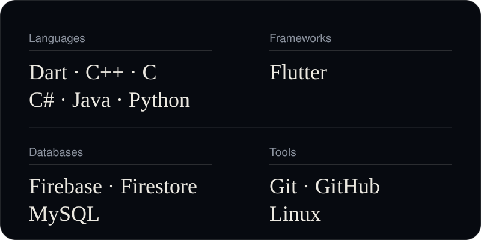
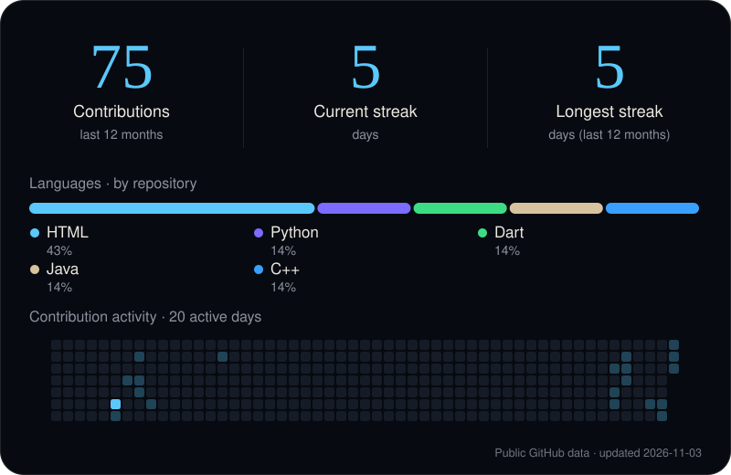

 

**Flutter Developer** · E-commerce & On-Demand Delivery Applications

[Portfolio](https://omar-adel-1.github.io/Portfolio/) &nbsp;·&nbsp; [LinkedIn](https://www.linkedin.com/in/omar-a-abouzaid-87691a34a/) &nbsp;·&nbsp; [Email](mailto:oaabouzeid@gmail.com)

## About Me

I'm **Omar Adel Abouzeid**, a Flutter developer from Egypt. I study Computer Science at **Assiut University — Faculty of Computers** (expected graduation 2028) and build mobile applications from UI implementation through to backend integration.

- Specialised in Flutter and mobile application development.
- Focused on **E-commerce** and **On-Demand Delivery** applications.
- Completed Flutter training at the National Telecommunication Institute (NTI).
- Always learning, building, and exploring new technologies.

## Technical Skills

## Featured Projects

  
  

  
  

## GitHub Analytics

## Let's Connect

[**Portfolio**](https://omar-adel-1.github.io/Portfolio/) &nbsp;·&nbsp; [**LinkedIn**](https://www.linkedin.com/in/omar-a-abouzaid-87691a34a/) &nbsp;·&nbsp; [**GitHub**](https://github.com/Omar-adel-1) &nbsp;·&nbsp; [**Email**](mailto:oaabouzeid@gmail.com)

Building. Learning. Improving. One commit at a time.

